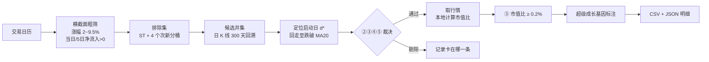

# K 线选股规则 v2 · 启动股筛选 + 成长基因标注

> 在最近 5 个交易日内，找出「**放量向上突破 MA20、有主力资金净流入、突破后未跌破均线**」的股票，再给它们标注一列「是否具备超级成长股基因」。
> 产出的是**值得投入研究时间的候选清单**，不是买入信号。


---

## 目录

- [一、为什么把这个项目公开](#一为什么把这个项目公开)
- [二、它解决的问题](#二它解决的问题)
- [三、核心设计：把「启动」定义成一个事件](#三核心设计把启动定义成一个事件)
- [四、输出长什么样](#四输出长什么样)
- [五、快速开始](#五快速开始)
- [六、参数与依据](#六参数与依据)
- [七、超级成长基因标注](#七超级成长基因标注)
- [八、实测数据](#八实测数据)
- [九、已知局限（务必先读）](#九已知局限务必先读)
- [十、路线图：怎么把概率真正提上去](#十路线图怎么把概率真正提上去)
- [十一、参与贡献](#十一参与贡献)
- [十二、免责声明](#十二免责声明)
- [十三、许可证](#十三许可证)

---

## 一、为什么把这个项目公开

这套规则是我一个人从零推出来的。它现在的状态是：**结构上自洽、口径上可复核、但收益层完全没有证据**。继续一个人闷头调参，收益曲线只会越来越像过拟合的自我安慰。

所以把它公开，动机很直接：

**1. 一个人的样本撑不起这类结论。**
所有参数都是在单一市场状态（2026-06 ~ 2026-10）里定标的。牛熊转换、风格切换、注册制下的新股供给变化，都会让同一组阈值失效。需要更多人在**不同的时间段、不同的市况**里跑一遍，才能知道哪些结论是结构的、哪些只是这四个月的巧合。

**2. 口径错误只有第二双眼睛能发现。**
项目里记录了三类已经踩过的坑：接口对长表达式静默返空、资金流字段丢失符号、粗筛只返回表达式引用到的列导致名单被静默清空。这些都是「看起来完全正常」的错误——不接受独立复核，早晚还会再踩一次。

**3. 「抓启动股」和「抓成长股」是两个不同的概率问题，都不该由一个人优化。**
- 抓启动股，难在**假突破**：放量上穿之后三天内跌回去的比例有多高？现在的规则里没有任何一条在度量这个。
- 抓成长股，难在**识别得早**：基因指标现在偏向中大盘（命中中位市值 90 亿 vs 全市场中位 64 亿），恰恰错过了成长最快的阶段。

这两个概率只能靠**大量真实样本 + 事后复盘 + 公开的失败案例**一点点逼近，不能靠某一次灵光一现的调参。这是我选择开源的核心原因：**把「我觉得这套规则行」变成「一批人各自验过、并且都知道它在什么情况下不行」。**

**4. 明确边界：这不是荐股，也不承诺收益。**
公开的是**方法、代码和踩坑记录**，不是名单。任何一只股票值不值得买，仍然要你自己读财报、看行业。

---

## 二、它解决的问题

人工翻 5000 只股票的 K 线，找出「本周刚放量突破、还没走坏」的票，是纯体力活，而且容易漏。

本项目的定位是把这个动作自动化，并且**把判断依据全部摊开**：每一只被剔除的股票都记录了它卡在哪一条上，可追溯、可复核、可反驳。

它**不做**这些事：

- 不预测涨跌，不给买卖点，不做仓位建议
- 不按「历史收益率」优化参数（见[第九节](#九已知局限务必先读)第 2 条）
- 不截断名单（宁可多给你 20 只让你筛，也不因为排名砍掉值得看的标的）

---

## 三、核心设计：把「启动」定义成一个事件

这是整个项目最关键的一处修正，也是早期版本最大的错误。

**错误做法**：把「站上 20 日线」和「放量」写成两个互不相关的条件。
实测结果：选出的 39 只股票里，**上穿 MA20 当日放量 ≥ 2 倍的只有 21%**，上穿日量能中位数仅 1.50 倍——规则根本没有在执行「放量突破」这个形态。

**正确做法**：要求「**当天上穿 MA20**」和「**当天放量**」在**同一时刻**发生，构成一个复合事件。

### 3.1 启动日 d\* 的定义

以下 5 组条件必须**同时**成立：

| # | 条件 | 精确口径 |
|:--:|---|---|
| ① | 当日向上穿越 MA20 | `收盘(d*−1) ≤ MA20(d*−1)` 且 `收盘(d*) > MA20(d*)` |
| ② | 上穿当日放量 | `成交量(d*) ≥ 1.75 × 前 5 个交易日成交量均值`（不含当日） |
| ③ | 日频条件 | 涨幅 `2% ~ 9.5%` ∧ 主力净流入 `> 0` ∧ 5 日净流入 `> 0` ∧ `净流入 ÷ 流通市值 ≥ 0.2%` |
| ④ | 结构条件 | `MA20 ≥ MA60 × 0.98` ∧ `MA20(d*) > MA20(d*−5) × 0.99`（近 5 日跌幅 ≤ 1%） |
| ⑤ | 风控 | 非 ST、非次新（**上市满 3 年**）、非停牌、非退市 |

> ③④ 全部在**启动日 d\*** 上判定，不是扫描日。这一条曾经写错（日频条件绑在扫描日），导致「3 天前突破、今天横盘」的股票被整批误杀。

### 3.2 扫描日 S 的条件

| # | 条件 | 口径 |
|:--:|---|---|
| ⑥ | 启动后未破坏（**定义性，不单独裁决**） | 自 d\*+1 到 S，每日收盘价始终 `> MA20` |
| ⑦ | 新鲜度 | `S − d* ≤ 4` 个交易日 |

**关于 ⑥ 的一个反直觉事实**：`find_start()` 是从 S 日往回走、遇到跌破 MA20 即停，所以 d\* **按定义**就是「到 S 日为止未被破坏的那一段」的起点。18 周、16731 个「股票×周」观测中，⑥ **阻断 0 只**——它从不会触发，是语义说明而非可调门槛。

由此产生一个刻意保留的行为：某股周一放量上穿、周三回踩跌破、周四再次上穿，规则**不会**判它失败，而是把 d\* 记为**周四这次新的上穿**。回踩后再放量上穿本身就是一个合法的新信号。

### 3.3 流程



---

## 四、输出长什么样

### 4.1 `csv/选股_<基准日>.csv`（UTF-8 with BOM，Excel 直接打开）

共 23 列，核心字段：

| 列 | 含义 |
|---|---|
| 基准交易日 / 序号 / 代码 / 名称 | — |
| **启动日** | d\*，该股向上穿越 MA20 且放量的那一天 |
| **距启动交易日** | `S − d*`，取值 0~4 |
| **启动日量能倍数** | `成交量(d*) ÷ 前 5 日均量` |
| 启动日涨幅% / 启动日净流入(万元) / 5日净流入(万元) | 启动当日的价格与资金 |
| **净流入占流通市值%** | 市值比，**本地用带符号原始数据计算**（见下） |
| 收盘价 / 距MA20% / 距MA60% / MA20 / MA60 / MA20÷MA60 | 位置与均线结构 |
| 流通市值(亿) / 总市值(亿) | 规模 |
| PE / PB / 换手率% | 估值与活跃度（**PE < 0 即当期亏损，只标注不过滤**） |
| **超级成长基因** | `是` / `否` / `无数据` / 空（空 = 基因数据获取失败，≠ 否） |

### 4.2 `database/result_<基准日>.json`

本次运行的**完整审计记录**：参数快照、粗筛池规模、逐条剔除计数（按原因归并）、入选名单的全部中间量。任何一份名单都能据此复现和复盘。

### 4.3 为什么市值比要本地算

数据源的 `MainInflowCircRate` 字段**丢弃了符号**：40 日、26546 条样本里，该字段为负的条数 **0**，而其中「实际主力净流出但字段为正」的有 **7586 条（29%）**。

所以本规则不使用该字段，改为本地计算：

```
市值比% = 当日主力净流入(元) ÷ 流通市值(元) × 100
```

---

## 五、快速开始

### 5.1 环境要求

- **Python 3.8+**，**仅用标准库**（无 `pip install`）
- **腾讯自选股 CLI `westock`**，默认路径 `~/.local/bin/westock`

> ⚠️ 本项目不自带数据源。`westock` 是一个本机 CLI，提供 `screen condition` / `screen label` / `kline` / `quote` / `trade-calendar` 等子命令，输出 markdown 表格。**换用其他数据源需要重写 `run()` 与 `md()` 两个函数**（约 30 行），规则逻辑无需改动。

### 5.2 目录结构

```
.
├── K线选股规则_v2.md      # 规则全文（权威文档，现行 v2.4）
├── screen_kline.py        # 选股主程序（现行 v2.3）
├── download_history.py    # 历史数据批量下载（回测/统计用）
├── database/              # 接口原始返回，按日期落盘（本地缓存）
└── csv/                   # 选股结果：选股_<基准日>.csv
```

### 5.3 运行

```bash
# 每周最后一个交易日收盘后运行（默认扫最近交易日，K=5，N=4）
python3 screen_kline.py

# 指定基准日
python3 screen_kline.py --date 2026-10-14

# 强制重新下载原始数据（默认复用 database/ 已有文件）
python3 screen_kline.py --refresh

# 换扫描周期（新鲜度窗口必须 = 周期 − 1）
python3 screen_kline.py --n 2     # 每 3 个交易日
python3 screen_kline.py --n 0     # 每个交易日
```

- **运行开销**：约 2~4 分钟（交易日历 1 次 + 粗筛 5 次 + 标签 25 次 + K 线约 35 批 + 行情 1 批）。
- **必须在收盘后（16:00 左右）运行**，否则横截面与 K 线不是当日收盘口径。
- **退出码**：`0` 正常 ｜ `1` 出错（含原始数据下载失败）。**出错时宁可不产出名单，也不产出不可信的名单。**

### 5.4 历史数据与回测

```bash
# 下载 91 个交易日的横截面 + 排除集 + 全市场 K 线（可断点续传）
python3 download_history.py --start 2026-06-01 --end 2026-10-14

# 只补 K 线（横截面/标签视为已完成）
python3 download_history.py --kline-only
```

`download_history.py` **只下载、不判断**。产物命名与 `screen_kline.py` 完全一致，可被直接复用。

---

## 六、参数与依据

每个参数都是**结构选择**（覆盖率、池子规模、阈值敏感性），不是收益率优化结果。

| 参数 | 取值 | 依据 |
|---|---|---|
| 扫描周期 K | **5 个交易日** | 覆盖率 75%，仅比每 3 日跑（78%）低 3 个百分点，但频率减半、漏跑容错期从 3 天延到 5 天 |
| 新鲜度窗口 N | **4**（= K−1） | N > K−1 只增加重复推送、不提高覆盖。每天跑却设 N=3 时，输出从 103 条涨到 300 条，去重后仍是同一批 98 只——**67% 是重复** |
| 放量倍数 `K_VOL` | **1.75×** | 原型「倍量」= 2×；实测 1.0~3.0 平滑无断崖（1.0→225 只 / 1.5→146 / **1.75→112** / 2.0→89 / 3.0→29） |
| 涨幅区间 | **2% ~ 9.5%** | 7% 上限紧贴分布 p95（实测 6.67%）；放宽到 9.5%（覆盖主板涨停）池子 +17%，名单保留 86% |
| 市值比下限 | **0.2%** | 恰落在池内市值比中位数（5 日实测 **0.201%**），是「中位数切割」而非尾部筛选，一调就腰斩 |
| C2 容忍度 | **1%** | 0.005 偏紧（五日约 −0.1%/日）；0→86 只 / **0.01→132** / 0.02→164，1% 仍属「走平」区间 |
| C3 比例 | **0.98** | 入选股 `MA20/MA60` 的 p5 = 0.988，该条只削末尾 28% |
| 上市时长 | **满 3 年** | ① 不满 3 年只有 1~2 份年报，看不出趋势；② 次新股价格由打新与情绪主导，均线不反映供需；③ 12/36 个月各有一次大规模解禁 |
| `MA60_GAP` | **关闭（0）** | 曾是最主要约束，改为「放量上穿」定义后天然贴近均线（中位 1.06），放宽到不限只多 6% 事件。参数保留，`--ma60-gap 1.15` 可复活 |

### 6.1 两个「反直觉」的实现约束

这两条不是风格问题，**删掉就会静默出错**：

**① 粗筛表达式里 `MainNetFlow > 0` 不可删除。**
它在逻辑上确实被「市值比 ≥ 0.2%」完全蕴含（流通市值恒正），但它同时承担**字段请求**职责——**接口只返回表达式引用到的列**。删掉后返回表里没有 `MainNetFlow`，本地市值比全部算不出来。

实测后果：粗筛池 703 → 924（+31%），**入选 10 只 → 0 只，且不报错**，拒绝明细看起来完全正常（`③ 启动日市值比 < 0.2%: 19`）。

> 任何字段（`ChangePCT`、`MainNetFlow5D` …）一旦不再被引用都会从返回里消失。改动 `CROSS_TPL` 后必须重跑验证；程序内已加两道 `raise` 防线。

**② 粗筛表达式不能太长。**
实测表达式过长时，**历史日期会静默返回空列表且不报错**（11 个条件的表达式在 2026-10-09 返回 0 只，而等价短表达式返回 5027 只）。这是旧版无法回测的根本原因。

**③ `westock quote` 的市值字段单位随 `--date` 变化**：无 `--date` 为亿元（`40.26`），有 `--date` 为元（`4263000000`）。程序按数量级归一化。

---

## 七、超级成长基因标注

K 线规则回答「**什么时候启动**」，基因标注回答「**这家公司有没有爆发力**」。这是两个独立问题，所以基因**只加一列，不筛选、不排序、不影响入选名单**。

### 7.1 三个指标（同时成立才标「是」）

| # | 指标 | 公式 | 判定 | 前提 |
|:--:|---|---|---|---|
| ① | **弹性系数** | 归母净利同比% ÷ 营收同比% | **> 1** | 归母净利 **> 0**；营收同比 **≥ 5%** |
| ② | **固定资产占比** | (固定资产 + 在建工程) ÷ 总资产 | **> 20%** | — |
| ③ | **行业扩产强度** | Σ行业在建工程 ÷ Σ行业固定资产 | **< 20%** | 行业营收增速 **> 0** |

**为什么设计成这样**（「周期躯壳 × 成长内核」框架）：

- **① 弹性系数** 直接度量「利润弹性超过营收弹性」，即经营杠杆是否在兑现。区分度最高。
- **② 固定资产占比** 是经营杠杆的**物理前提**。没有固定成本就没有利润弹性——它不负责筛选，负责排除轻资产（软件、平台、贸易商）。
- **③ 行业扩产强度**（越低越好）度量**供给瓶颈**。实测 2026-10-14：工业金属 **15.2%**（行业营收 +26%），半导体 **29.9%**（行业营收 +298%）——**需求越猛，扩产越凶，瓶颈关闭得越快**，所以要给上限。

### 7.2 两个前提不是可选的（实测反例）

**长春燃气（sh600333）**：前一期亏 1359 万、当期亏 2179 万，亏损**扩大**了，但 `同比 = −2179 ÷ −1359 − 1 = +60.4%` 被算成「正增长」，再除以营收增速得到「弹性 5.45」。**两个负数相除，符号完全失真。** 同时它所在的燃气Ⅱ行业营收 **−5.05%**，萎缩行业里的「低扩产」不是瓶颈，是价值陷阱。

**新世界（sh600628）**：营收 +1.12%、利润 +4.2%，`4.2 ÷ 1.12 = 3.78` 看起来很漂亮。**分母趋近 0 时，比率会把噪声放大成信号。** 它本质上是一家营收停滞的百货公司。

> 修正后，2026-10-14 全市场命中由 676 → **493 只**（标注并未失效），而该周 K 线选出的 10 只**全部不合格**——这是真实结果，不是 bug。

### 7.3 取值含义

| 取值 | 含义 |
|---|---|
| `是` | 三个指标及其前提**全部**成立 |
| `否` | 至少一项不成立 |
| `无数据` | 不在基因快照里，或其行业成员不足 5 只 |
| *(空)* | **基因数据整体获取失败**——与「否」含义完全不同，不要混淆 |

基因是附加标注，不该因为它失败就让整周选股作废；但也**绝不能静默标成「否」**，那会被误读为「已确认没有基因」。

---

## 八、实测数据

**样本**：2026-06-08 ~ 2026-10-14，18 个周频基准日，**16731 个「股票×周」观测**。

### 8.1 逐关阻断（按短路顺序）

| 关卡 | 阻断数 | 占比 |
|---|---:|---:|
| ⑦ 距启动 > N=4 | 5907 | 35.31% |
| 未站上 MA20 | 5321 | 31.80% |
| ② 启动日放量 < 1.75× | 3847 | 22.99% |
| ③ 启动日未过日频条件 | 744 | 4.45% |
| ④ MA20 < MA60×0.98 | 426 | 2.55% |
| ④ MA20 近 5 日跌逾容忍度 | 174 | 1.04% |
| ③ 市值比 < 0.2% | 98 | 0.59% |
| 无 K 线 / 历史不足 | 95 | 0.57% |
| ⑤ 次新（未满 3 年） | 7 | 0.04% |
| ⑥ 启动后跌破 MA20 | **0** | 0.00% |
| ⑤ ST | 0 | 0.00% |
| ✅ **通过全部条件** | **112** | **0.67%** |

**真正的约束是「刚启动」这件事本身**：⑦ 与「未站上 MA20」合计 67%。三个技术条件（放量、结构）再拦 27%。市值比在最终关口拦掉 47%（210 → 112），是最后一道有效闸门。

### 8.2 输出层市值分布（18 周累计）

| 流通市值 | 进池 | 入选 | 裁决通过率 | 入选率 |
|---|---:|---:|---:|---:|
| <50 亿 | 6885 | 50 | 1.2% | 0.7% |
| 50–100 亿 | 4034 | 32 | **1.4%** | **0.8%** |
| **100–200 亿** | **2638** | **23** | **1.5%** ← 最高 | **0.9%** ← 最高 |
| 200–500 亿 | 1883 | 5 | 1.1% | 0.3% |
| >500 亿 | 1291 | 2 | 0.7% | 0.2% |

**50–200 亿是全部档位中通过率最高的区间**，不存在被系统性踢出的问题。真正被压制的是 200 亿以上（入选率 0.2~0.3%），主因是「市值比 ≥ 0.2%」要求大市值股单日主力净流入更大。

---

## 九、已知局限（务必先读）

1. **核心前提未经实证。** 40 个交易日的回测显示：**包括本规则在内的所有变体，相对沪深 300 的按日超额收益都不显著（最高 |t| = 1.78，低于 0.05 显著性门槛）**。「值得研究」这个判断目前**纯粹基于概念推理，没有收益层面的证据**。
2. **参数取值多为结构选择，非收益优化。** 见[第六节](#六参数与依据)——依据是覆盖率、池子规模、阈值敏感性，不是收益率。
3. **样本期单一。** 绝大多数统计基于 2026 年 6~10 月这一段市场状态。
4. **名单规模波动大。** K=5 下 8 次扫描里 6 次是 1~9 只，2 次是 25~26 只（对应普涨期）。
5. **基因标注偏向中大盘。** 命中中位市值 90 亿 vs 全市场中位 64 亿；命中中 <100 亿占 54% vs 全市场 65%。与「在中小盘阶段识别基因」的目标有偏差，成因是三条指标叠加的系统性结果。
6. **早期版本的经验全部失效。** 把「启动」定义改正确之后，整个规则的重心变了（例如 `close/MA60 < 1.15` 从「主要约束」变成「几乎失效」）。任何基于旧名单的调参结论都必须重测。

---

## 十、路线图：怎么把概率真正提上去

下面每一条都是**待解决的问题**，不是已完成的功能。欢迎认领。

### 10.1 抓启动股：先把「假突破率」量出来

| # | 问题 | 现状 |
|---|---|---|
| P1 | **假突破率基线缺失** —— 放量上穿后 N 日内跌回 MA20 以下的比例是多少？ | 完全没有度量。这是判断「规则有没有用」的第一块基石 |
| P2 | **零假设对照** —— 随机抽同样数量的「当日涨幅 2~9.5%」的股票，20 日表现与本名单比有多大差异？ | 未做。没有对照组，就无法排除「这四个月本来就在涨」 |
| P3 | **多周期共振** —— 周线 MA20/MA60 与日线信号同向时，命中率是否显著更高？ | 未做 |
| P4 | **板块扩散** —— 同一申万二级行业内 2 只以上同时启动，是否比孤立启动更可靠？ | 未做 |
| P5 | **失效监控** —— 按月滚动统计通过率与后续表现，规则退化时自动报警 | 未做 |

### 10.2 抓成长股：把基因从「标注」变成「排序依据」

| # | 问题 | 现状 |
|---|---|---|
| G1 | **基因指标的区分度验证** —— 标「是」组 vs「否」组的未来 12 个月营收/利润增速，差多少？ | 未做。这是验证基因有没有用的唯一方式 |
| G2 | **向中小盘下沉** —— 现有三条指标系统性偏向资本密集的成熟公司，如何在小市值阶段识别同样的结构？ | 未解，可能是本项目最有价值的问题 |
| G3 | **补充维度** —— 经营现金流/净利润、应收账款周转、资本开支/折旧、股东户数变化、订单/产能公告 | 未做 |
| G4 | **基数效应修正** —— 弹性系数在利润基数接近 0 时会爆炸（实测最高数万倍），目前只做阈值比较 | 未修 |

### 10.3 工程与数据

- **数据源适配层**：把 `westock` 调用抽象成接口，支持 Tushare / AkShare / 聚宽等，降低复现门槛
- **增量化与并发安全**：当前 CLI 有本机限频器，并发 3 就会全部失败，必须串行
- **基准日口径统一**：市值比目前是 `d* 日净流入 ÷ S 日流通市值`，`age=4` 时分母滞后最多 4 个交易日
- **回测框架**：把 `download_history.py` 的产物接上统一的评估脚本（年化、最大回撤、胜率、盈亏比）

---

## 十一、参与贡献

### 11.1 最有价值的四种贡献

1. **不同时间段的重跑结果** —— 尤其是 2024 年以前、以及熊市/急跌段的样本。附上 `result_<日期>.json`，最有说服力。
2. **反例** —— 找出「应该入选却被剔除」或「入选明显是垃圾」的具体标的，并说清卡在哪一条。**失败的案例比成功的案例更有价值。**
3. **口径纠错** —— 数据字段含义、单位、复权方式、停牌处理，任何你发现的坑。
4. **新指标/新数据源** —— 只要能用同一套裁决框架评估（逐关阻断 + 敏感性），就欢迎。

### 11.2 提交规范

- **Issue 优先**：改规则前先开 Issue 说明「改什么、为什么、预期影响多少只」，避免无效 PR。
- **任何改动都要有对照数字**：不接受「我觉得 1.5 更好」，只接受「1.5 → 146 只，1.75 → 112 只，且新增部分是 X 类形态」。
- **修改必须登记时间**：本项目有一条硬规范——每次改动 `screen_kline.py` 或规则文档，都必须在 `K线选股规则_v2.md` 第十节的登记表中记录**精确到分钟的修改时间**与变更内容。未登记时间的修改视为不合规。
- **不要提交 `database/`**：接口原始返回约 86 MB，属本地缓存。PR 里只带代码、文档和必要的少量样例。

### 11.3 讨论什么

- 规则设计、指标构造、统计口径 → Issue（`discussion` 标签）
- 具体某只股票为什么被剔除 → Issue，附 `database/result_<基准日>.json`
- 数据源接入、性能优化 → PR

---

## 十二、免责声明

本项目是**量化选股方法的研究与工程实践**，不构成任何投资建议、要约或承诺。

- 作者不是持牌投资顾问，不推荐任何具体证券。
- 代码与文档按「现状」提供，不保证正确性、完整性或适用性。
- 历史统计不代表未来表现。股市有风险，任何交易决策及后果由使用者自行承担。
- 数据来自第三方接口，其准确性、完整性与可用性由数据提供方决定。

---

## 十三、许可证

尚未指定正式许可证（TBD）。在确定之前，默认保留所有权利。

若你打算长期协作，建议采用 **MIT** 或 **Apache-2.0**——只需补一个 `LICENSE` 文件，本 README 无需改动。

---

## 致谢

- 数据源：腾讯自选股 CLI `westock`
- 规则全文与全部踩坑记录：[`K线选股规则_v2.md`](./K线选股规则_v2.md)——比本 README 详细得多，**动手改代码前请先读它**
